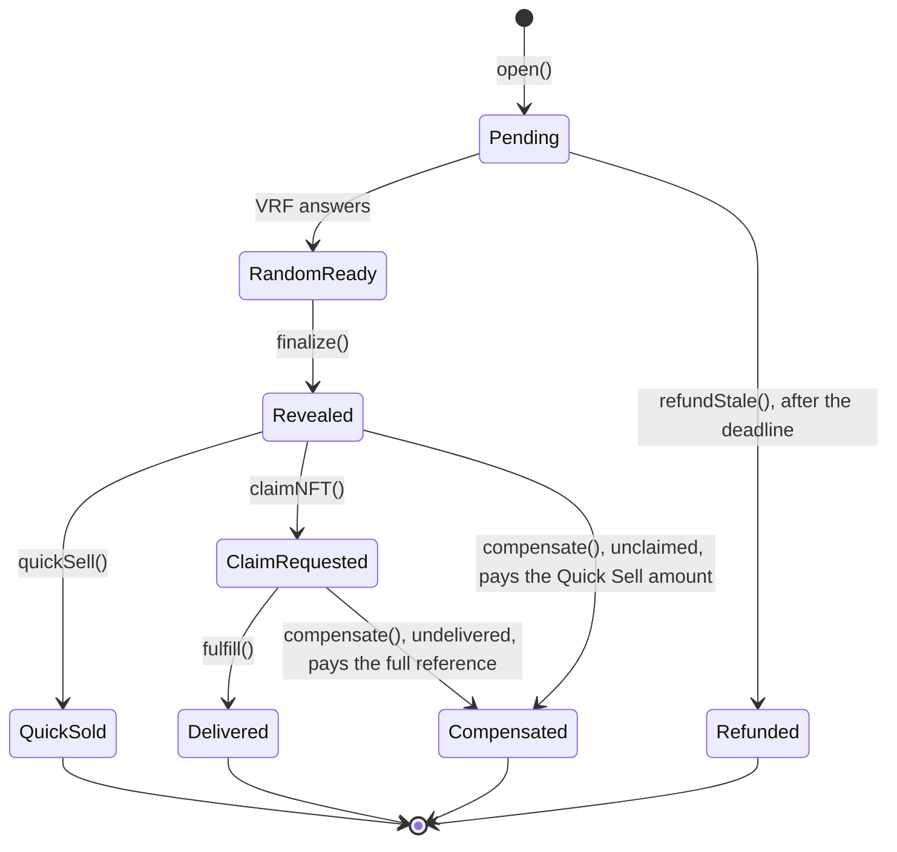

<div align="center">

```text
      .-------------.
     /  o   O   o    \        _____ __  __ ____   ___
    |   O   o   O   o |      | ____|\ \/ /|  _ \ / _ \
    |   o   O   o   O |      |  _|   \  / | |_) | | | |
     \    o   O   o  /       | |___  /  \ |  __/| |_| |
      '-------------'        |_____|/_/\_\|_|    \___/
     |   [ E X P O ]  |         ____    _    ____ _   _    _
     |                |        / ___|  / \  / ___| | | |  / \
     |   (+)     ___  |       | |  _  / _ \| |   | |_| | / _ \
     |          | o | |       | |_| |/ ___ \ |___|  _  |/ ___ \
     |__________|___|_|        \____/_/   \_\____|_| |_/_/   \_\
```

**Insert coin. Turn the handle. Keep the capsule or sell it back.**

The smart contracts behind [Expo Gacha](https://expogacha.com): NFT gacha machines on Ethereum,
drawn with Chainlink VRF and settled by a shared on-chain reserve.

[](https://github.com/expogacha/contracts/actions/workflows/ci.yml)
[](LICENSE)
[](foundry.toml)
[](https://getfoundry.sh)

</div>

## How it works

A machine (a *configuration*) has a fixed price and four tiers of prizes: Common, Uncommon, Rare and Epic. A buyer pays
the price and Chainlink VRF picks the prize. The buyer then chooses:

- **Keep it:** the operator delivers the NFT from the vault, and the transfer to the buyer is checked on-chain.
- **Sell it back:** the pool pays the Quick Sell amount immediately, a share of the prize's reference value set by the
  machine.

Every opening is a state machine with a way out on each path, so a stuck draw or a failed delivery still ends in a
payment to the buyer as long as the reserve can pay it.



### What v3.2 adds

- **Value-weighted draws.** One on-chain entry per prize, with a draw weight that cannot rise with value inside a tier.
- **Locked prizes.** Before randomness is requested, each opening fixes the cover the free reserve can pay, and it can
  only draw prizes that cover pays. A prize the reserve cannot pay yet is not winnable. The buyer passes `minCover` to
  refuse an opening with less cover than they expect.
- **Price bands for launches.** Launchpad prizes must sit in the band of their tier relative to the machine price:
  Common `[0.5P, P)`, Uncommon `[P, 2P)`, Rare `[2P, 4P)`, Epic `[4P, ∞)`. The owner's own machines are exempt from the
  bands and keep the other checks.
- **Hard limits on every machine.** Expected reference value at most the price (`MAX_RETURN_BPS`), purchase budget at
  most 1.5 times the reference (`MAX_BUDGET_MARGIN_BPS`), liabilities non-decreasing and weights non-increasing inside
  a tier, odds summing to 10,000 basis points.

## Contracts

| Contract | Role |
|---|---|
| [`ExpoGachaPool`](src/v3/ExpoGachaPool.sol) | The reserve and every opening: draw, reveal, Quick Sell, delivery, compensation, refund |
| [`ExpoVault`](src/ExpoVault.sol) | Upgradeable custody (Transparent proxy). Holds each NFT between purchase and delivery; only the pool can release one to a buyer |
| [`ExpoAdmissionRegistry`](src/v3/ExpoAdmissionRegistry.sol) | Which collections may be used, bound to a fork-test evidence digest, the code hashes of the collection and the vault implementation, and an expiry |
| [`ExpoLaunchpad`](src/v3/ExpoLaunchpad.sol) | Permissionless launches from quotes signed by Expo's quote key. Creator fee of at most 3% |
| [`ChainlinkRandomness`](src/ChainlinkRandomness.sol) | Chainlink VRF v2.5 adapter behind every draw |

The other files in `src/` are earlier versions, test assets and helpers: `ExpoPool` and `ExpoCollectionPool` (V1 and V2
settlement, not deployed on mainnet), `MockAssets`, `ExpoTestCollection` and `ExpoTransferProbe`. `ExpoPool.sol` still
provides the `IRandomness` interface the pool imports.

### Who can do what

| Role | Can | Cannot |
|---|---|---|
| **Owner** | Admit and revoke collections, create and disable machines, set the configurator, guardian and launchpad cap, withdraw free reserve within a 24-hour cap | Withdraw reserve held for openings. Raise the withdrawal cap without a 48-hour delay. Raise the launchpad cap above 25% |
| **Operator** | Deliver an acquired token and be reimbursed that prize's fixed budget | Create or change machines, withdraw, or redirect a delivery |
| **Quote signer** | Sign launch economics | Hold funds |
| **Guardian** | Disable a machine | Anything else |
| **Creator** | Launch from a signed quote, disable their own machines, withdraw accrued fees | Launch outside the price bands |
| **Chainlink VRF adapter** | Answer a pending draw | Anything else |

## Deployments

| Network | Version | Pool | Vault | Registry | Launchpad |
|---|---|---|---|---|---|
| Ethereum mainnet | v3.1 | [`0x2388…F803`](https://etherscan.io/address/0x2388B90321c5788f60DF3941715982ed12afF803#code) | [`0xcA48…bf5c`](https://etherscan.io/address/0xcA4847FEC66fC37e00867c917DFB92837118bf5c#code) | [`0x48fE…9F73`](https://etherscan.io/address/0x48fEa85e9587C2015e7d479e5F1b71F7446B9F73#code) | [`0x7b9b…0ef2`](https://etherscan.io/address/0x7b9bB2c72c2de255840B75D08e7d4C4da58D0ef2#code) |
| Sepolia (test deployment, valueless assets) | v3.1 | [`0x52AA…6735`](https://sepolia.etherscan.io/address/0x52AAf036B2CDeC1e298F739fB8f332AB7D586735) | [`0xb055…a016`](https://sepolia.etherscan.io/address/0xb0558b1Da3921DDA7e8A77F063b107ab83b3a016) | [`0x0DC5…4523`](https://sepolia.etherscan.io/address/0x0DC5877e45fDDe901B14420D7cB793C12c704523) | [`0xE0f5…F31e`](https://sepolia.etherscan.io/address/0xE0f5F810D3AbB43D861A8C5069d607c6490BF31e) |

Every address and setting is in [`deployments/`](deployments). The `usdc` field holds the pool's payment token, which
is canonical WETH on these deployments, and names ending in `Usdc` are historical.

> [!IMPORTANT]
> **`src/` is v3.2, the next version. It is not deployed yet.** What runs on-chain today is the frozen v3.1 source in
> [`v31/src/`](v31/src). This table gets the v3.2 addresses once they exist.

### Verify the deployed code yourself

`v31/` compiles with the settings of the deployment, so the build can be compared with the chain, metadata hash
included, with immutables masked:

```sh
npm ci
MAINNET_RPC_URL=<your RPC URL> npm run check:artifacts
```

```text
Frozen v3.1 sources: unchanged.
ABIs: 7 match the sources.
ExpoGachaPool: matches the mainnet code at 0x2388B90321c5788f60DF3941715982ed12afF803.
ExpoLaunchpad: matches the mainnet code at 0x7b9bB2c72c2de255840B75D08e7d4C4da58D0ef2.
```

CI runs the same check without the RPC comparison.

## Build and test

Node.js 22 or later is the only requirement: Foundry and the Solidity dependencies are pinned through npm.

```sh
git clone https://github.com/expogacha/contracts.git
cd contracts
npm ci

npx forge build   # compile
npx forge test    # unit, adversarial, fuzz and invariant suites
```

The suite has 281 tests in 37 suites. 20 of them replay real collections and marketplace routes on a mainnet fork and
are skipped unless you provide an archive RPC:

```sh
EXPO_FORK_RPC_URL=<your RPC URL> npx forge test --match-path 'test/*Fork.t.sol'
```

| Tests | What they cover |
|---|---|
| `test/v3/ExpoGachaV3.t.sol` | The opening lifecycle, machine kinds and launches |
| `test/v3/ExpoGachaOdds.t.sol`, `ExpoGachaLocked.t.sol`, `ExpoGachaRarity.t.sol` | Bands, weighted draws, locked prizes and curated tiers |
| `test/v3/ExpoGachaAdversarial.t.sol`, `ExpoGachaHardening.t.sol` | Attacks on settlement and owner powers, with regression tests |
| `test/v3/ExpoGachaInvariant.t.sol`, `ExpoGachaWethInvariant.t.sol` | Stateful solvency and accounting invariants |
| `test/v3/HostileNFT.t.sol` | Lying, re-entrant and non-standard collections |
| `test/v3/ExpoVaultUpgrade.t.sol` | Proxy storage, upgrades and the admission binding |
| `test/ExpoMainnetGachaFork.t.sol` | Purchase into the vault and delivery on real collections (needs an RPC) |

## Repository layout

```text
src/          current protocol (v3.2), not deployed yet
v31/          frozen v3.1 sources, the code running on-chain
test/         Foundry test suites
script/       vault deployment and upgrade scripts, artifact check
abi/          exported ABIs (the V32 suffix marks v3.2)
deployments/  public addresses and settings per network
```

Comments in the sources cite `docs/NN`. Those are the project's internal design documents, and they are not part of
this repository. Sources are published unchanged so they stay identical to what gets compiled and verified.

## Security

How the protocol protects buyers and its reserve:

- **Provable draws.** Every prize is picked by Chainlink VRF, and the odds of a machine are published on-chain when it is created.
- **Openings are covered up front.** The reserve an opening could owe is set aside before randomness is requested, and the owner can only withdraw free reserve, within a 24-hour cap that takes 48 hours to raise.
- **Every path ends.** A draw that never arrives is refunded, and an undelivered claim is compensated at the full reference.
- **Bound admission.** A collection's review is tied to its code hash and the vault implementation's. Deliveries stop if either changes or the review expires.
- **Checked delivery.** The pool checks token ownership on-chain before and after each transfer.

The test suite covers this with adversarial tests, stateful invariants, hostile NFT mocks and mainnet fork replays, and
you can [verify the deployed bytecode](#verify-the-deployed-code-yourself) yourself.

Found a vulnerability? See [SECURITY.md](SECURITY.md).

## License

[MIT](LICENSE)
